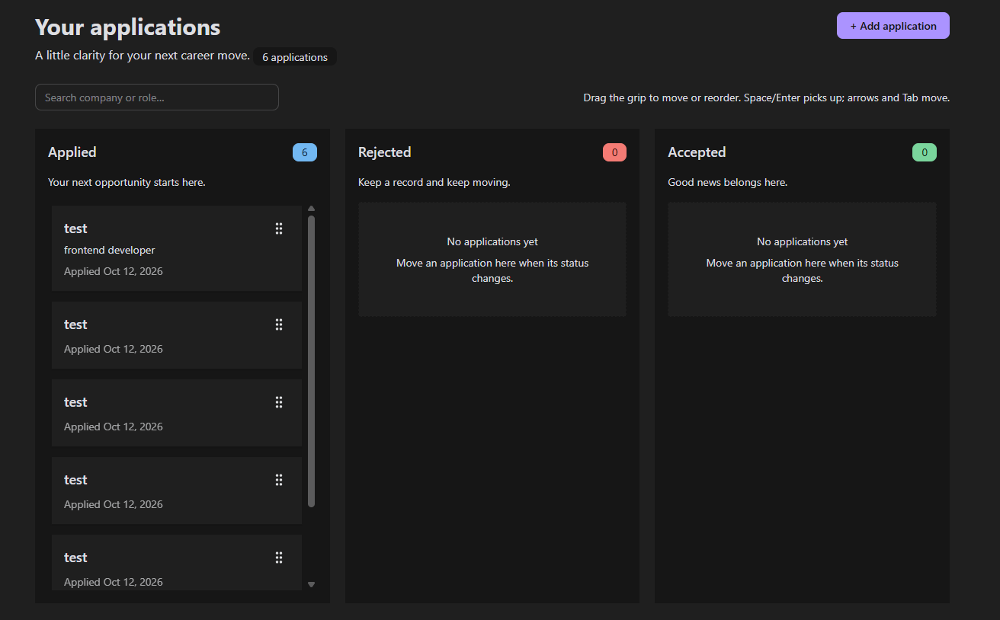
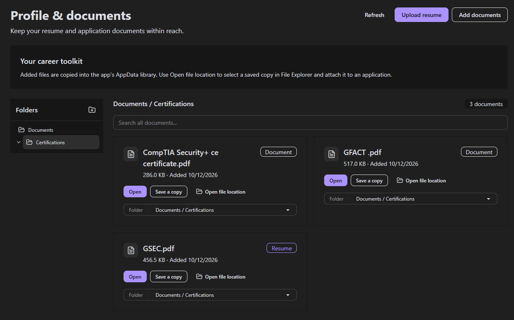
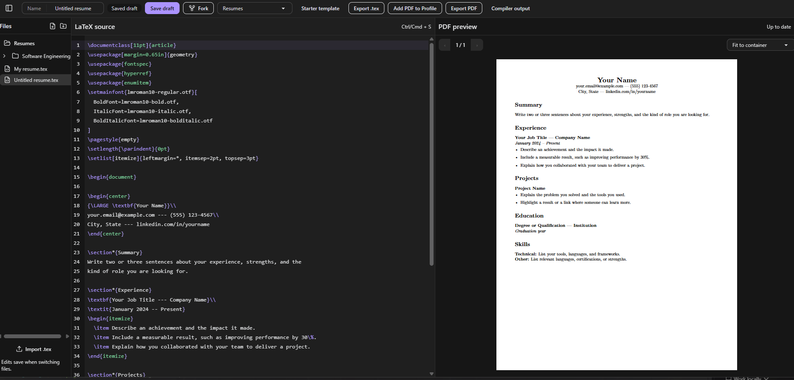

<p align="center">
  
</p>

# Sorrel

Sorrel is a desktop job application tracker built with Svelte and Rust using Tauri. Track applications, keep your documents organized, and build LaTeX resumes from one workspace.

## Features

- **Application board:** Move and reorder jobs across Applied, Rejected, and Accepted with animated drag and drop. Each column scrolls independently, and cards show the company, role, and application date.
- **Application details:** Right-click a card to view its status, dates, notes, and job description. Paste a description when adding a job or update it later in the details modal.
- **Statistics:** Review application totals, status counts, unique companies, acceptance rate, and six months of application activity.
- **Document library:** Organize resumes, cover letters, and other files in nested folders. Uploads are copied into AppData with recognizable filenames. Open files, save copies, or reveal their location in File Explorer when attaching them to an application.
- **LaTeX resume builder:** Write resumes in a Code editor and preview compiled PDFs. Create folders, import and export `.tex` files, fork resumes, export PDFs, and add finished PDFs to your document library.
- **Themes:** Switch between Light and Dark themes.

## Screenshots

### Application board



### Profile and document library



### LaTeX resume builder



## Getting started

### Prerequisites

Install Bun, Node.js, and Rust, along with the [Tauri platform dependencies](https://v2.tauri.app/start/prerequisites/).

### Run the desktop app

From the project root:

```sh
bun install
bun run tauri dev
```

The development command prepares the Tectonic compiler and starts the frontend and desktop app. Initial setup requires an internet connection to download the compiler. The first resume compilation may also download TeX packages; subsequent compilations reuse cached packages.

### Build the desktop app

```sh
bun run tauri build
```

Build artifacts are written to `src-tauri/target/release/`, with installers in its `bundle/` directory.

### Preview the frontend

```sh
bun run dev
```

The browser preview supports interface development and resume editing. Persistent storage, native file actions, and PDF compilation require the desktop app.
